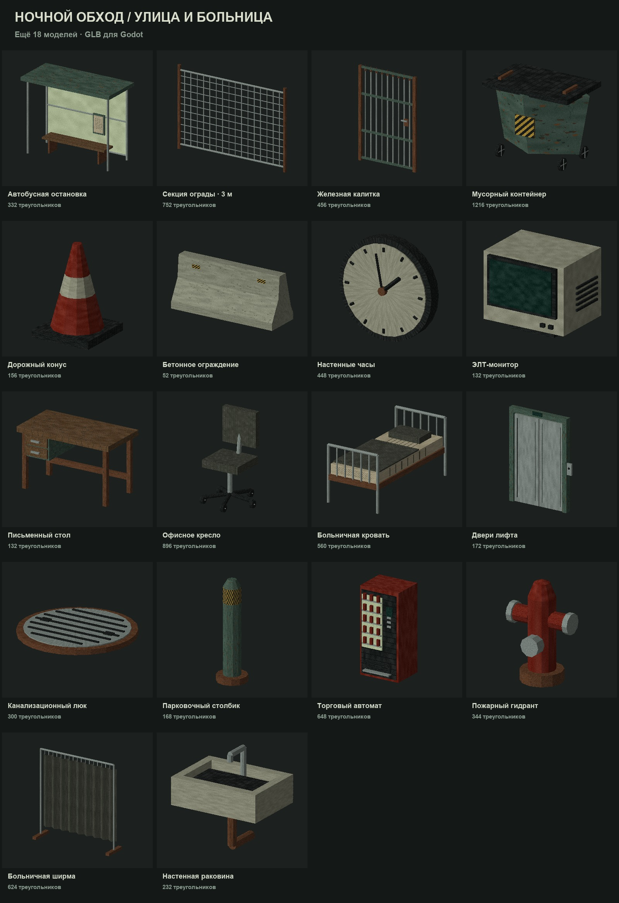
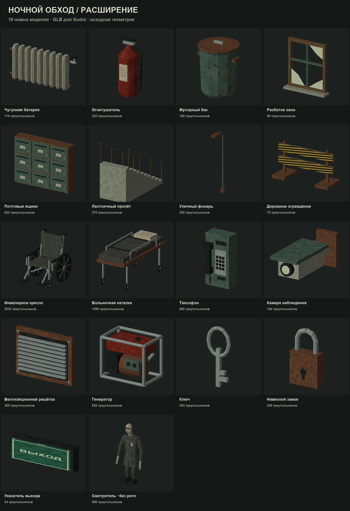

# Ночной обход / Night Shift — Horror Models for Godot

**72 оригинальные low-poly модели · GLB со встроенными текстурами · играбельный проект Godot**

## Продолжить разработку игры

Папка [Game](Game) — полный проект Godot 4.7.2: двор, подъезд, скрипты, модели, текстуры и проверки. На Windows скачайте весь репозиторий через **Code → Download ZIP**, распакуйте и откройте `Game/project.godot` в Godot. Папку `.godot` переносить не требуется: редактор создаст кэш импорта сам.

Исходники моделей, OBJ, материалы, текстуры и генераторы лежат отдельно в `Assets/NightShift` и `Tools`. Для работы с готовой игрой достаточно папки `Game`.

Набор для прототипа городского хоррора: подъезд, улица, больница и первый противник. Модели созданы процедурно с помощью AI-инструментов; ассеты Cry of Fear не используются.

[Скачать весь репозиторий ZIP](https://github.com/yaroslavyanky/night-shift-models/archive/refs/heads/main.zip) · [GLB-модели](Assets/NightShift/GLB) · [Отчёт проверки](validation.json)

## Улица и больница



## Предметы и противник



## Базовый набор


## Импорт в Godot 4

1. Скопировать нужные файлы из `Assets/NightShift/GLB` в папку проекта Godot.
2. Дождаться импорта и перетащить GLB из панели FileSystem в сцену.
3. Масштаб моделей — метры, вертикаль Y; большинство предметов смотрит в локальную +Z. Для фонаря направить игровой луч вдоль +Z модели.
4. Коллизии, источники света и игровую логику добавить в наследуемой сцене Godot. В моделях они не встроены.

Каждый GLB самостоятельный: геометрия, материалы и PNG внутри. Отдельно переносить Textures для GLB не нужно. Godot рекомендует glTF 2.0: [официальная инструкция](https://docs.godotengine.org/en/stable/tutorials/assets_pipeline/importing_3d_scenes/available_formats.html).

## Что готово

- 72 GLB и соответствующие OBJ/MTL, общие текстуры 512×512.
- Масштаб, UV и плоские нормали. В GLB сохранены исходные pivots.
- Дверное полотно отдельно от коробки; ось вращения двери проходит через начало координат по Y.
- «Смотритель» высотой около 2,12 м, 956 треугольников: **статическая модель без скелета и анимаций**.
- У кроватей, колясок и остальной мебели детали пока объединены в статические модели.

Стиль намеренно грубый и малополигональный. Стекло пока непрозрачное; normal maps, lightmap UV2, LOD, риг и анимации не включены. Игра и переход между двумя сценами проверены в Godot 4.7.2 на macOS. Превью моделей созданы собственным CPU-рендерером из экспортируемой геометрии.


## Размеры

Размеры в таблице — полный bounding box XYZ в метрах, включая выступающие детали.

| Модель | Треугольников | Размер XYZ, м |
| --- | ---: | --- |
| Floor_3m | 12 | 3.0 × 0.16 × 3.0 |
| Wall_3m | 48 | 3.0 × 2.8 × 0.21 |
| DoorFrame | 72 | 1.43 × 2.295 × 0.262 |
| Door_17 | 284 | 1.124 × 2.08 × 0.18 |
| Locker | 252 | 0.62 × 1.85 × 0.552 |
| FuseBox | 276 | 0.58 × 0.96 × 0.24 |
| Bench | 156 | 1.6 × 0.95 × 0.51 |
| Pipe | 612 | 0.283 × 2.57 × 0.289 |
| WallLamp | 108 | 0.48 × 0.19 × 0.134 |
| Flashlight | 396 | 0.1 × 0.1 × 0.279 |
| Fuse | 120 | 0.029 × 0.07 × 0.03 |
| Crate | 108 | 0.64 × 0.5 × 0.555 |
| Radiator | 716 | 1.345 × 0.622 × 0.18 |
| FireExtinguisher | 252 | 0.287 × 0.612 × 0.223 |
| TrashBin | 180 | 0.68 × 0.842 × 0.66 |
| BrokenWindow | 96 | 1.6 × 1.765 × 0.34 |
| Mailboxes | 624 | 1.35 × 1.04 × 0.278 |
| Stair_3m | 576 | 1.494 × 2.523 × 3.0 |
| StreetLamp | 200 | 0.32 × 3.993 × 1.29 |
| RoadBarrier | 72 | 1.68 × 0.96 × 0.64 |
| Wheelchair | 2032 | 0.705 × 1.002 × 1.14 |
| Gurney | 1596 | 0.79 × 0.96 × 1.94 |
| Payphone | 660 | 0.43 × 0.86 × 0.365 |
| SecurityCamera | 164 | 0.21 × 0.24 × 0.568 |
| VentCover | 260 | 0.65 × 0.5 × 0.092 |
| Generator | 620 | 0.81 × 0.68 × 0.555 |
| Key | 324 | 0.041 × 0.094 × 0.006 |
| Padlock | 248 | 0.075 × 0.138 × 0.029 |
| ExitSign | 24 | 0.52 × 0.18 × 0.087 |
| Watcher | 956 | 1.023 × 2.12 × 0.441 |
| BusShelter | 332 | 3.2 × 2.52 × 1.45 |
| Fence_3m | 752 | 3.09 × 2.15 × 0.09 |
| IronGate | 456 | 1.47 × 2.23 × 0.128 |
| Dumpster | 1216 | 1.7 × 1.252 × 1.06 |
| TrafficCone | 156 | 0.39 × 0.57 × 0.39 |
| ConcreteBarrier | 52 | 2.0 × 0.9 × 0.66 |
| WallClock | 448 | 0.44 × 0.44 × 0.085 |
| CRTMonitor | 132 | 0.49 × 0.42 × 0.391 |
| Desk | 132 | 1.3 × 0.795 × 0.688 |
| OfficeChair | 896 | 0.603 × 1.05 × 0.661 |
| HospitalBed | 560 | 0.97 × 0.995 × 2.05 |
| ElevatorDoors | 172 | 1.785 × 2.455 × 0.192 |
| Manhole | 300 | 0.72 × 0.05 × 0.72 |
| Bollard | 168 | 0.24 × 0.8 × 0.24 |
| VendingMachine | 648 | 0.85 × 1.8 × 0.82 |
| Hydrant | 344 | 0.48 × 0.71 × 0.31 |
| HospitalCurtain | 624 | 1.895 × 1.972 × 0.5 |
| WallSink | 232 | 0.56 × 0.595 × 0.4 |

## Исходники

`Tools/build_assets.py` создаёт геометрию, текстуры и превью. `extra_models.py` и `street_models.py` описывают дополнительные предметы; `export_glb.py` формирует GLB. Запускать только основной генератор:

```sh
python3 -m pip install -r Tools/requirements.txt
python3 Tools/build_assets.py
python3 Tools/validate_assets.py
```

`Legacy/Unity/NightShiftKit.cs` — прежняя утилита только для первых 12 моделей. Для Godot она не требуется.

Original AI-assisted procedural urban horror art kit. 48 static meshes, embedded-texture GLB files for Godot, OBJ sources and reproducible Python tooling. Watcher character is unrigged. No game engine runtime validation yet.
