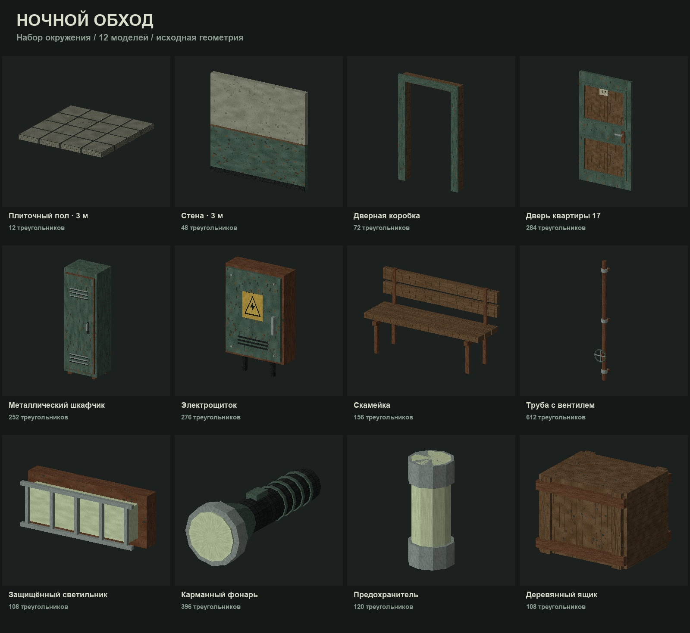
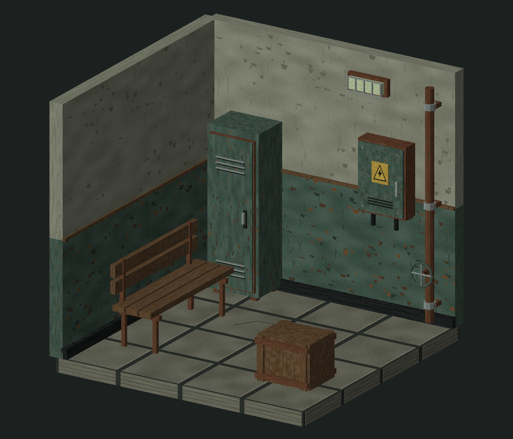

# Ночной обход / Night Shift — Low-poly Horror Kit

**12 моделей · 2444 треугольника · 10 текстур 512×512 · OBJ + MTL**

[Скачать готовый набор ZIP](NightShiftArt.zip?raw=true)

Original low-poly props and modular environment pieces for an urban horror prototype. Includes OBJ meshes, textures, a reproducible Python generator and a Unity editor utility. Assets were created with AI-assisted procedural tools; these are not assets from Cry of Fear. Unity import validation is pending.

12 оригинальных low-poly моделей для прототипа городского хоррора. Собственные геометрия и текстуры; ассеты Cry of Fear не используются. Это набор предметов и архитектуры, без персонажей, анимации и игрового кода.

## Импорт в Unity

1. Создать проект Universal 3D (URP).
2. Скопировать всю папку `Assets/NightShift` из этого набора в `Assets` проекта. OBJ, MTL и Textures должны остаться вместе.
3. Дождаться импорта, выбрать **Tools → Night Shift → Build prefabs and demo scene**.
4. Открыть созданную сцену из `Assets/NightShift/Scenes` двойным щелчком. Скрипт создаёт материалы и префабы с MeshCollider. Текущую открытую сцену он не заменяет.

Повторный запуск обновляет материалы и префабы набора; демонстрационная сцена сохраняется под новым свободным именем. Поддерживается URP и Standard, HDRP не настроен. Для движущихся физических объектов заменить статический MeshCollider на простые коллайдеры или convex.

## Размеры и применение

Одна единица исходного OBJ — один метр, вертикаль Y. Передняя сторона предметов смотрит в +Z. Масштаб импорта должен быть 1. Геометрия плоско затенённая, UV и нормали записаны в OBJ. 10 общих текстур 512×512; имитация стекла непрозрачная, светильники не создают свет сами.

| Модель | Размер / назначение |
| --- | --- |
| Floor_3m | Плиточный пол 3×3 м, верхняя поверхность Y=0 |
| Wall_3m | Стена шириной 3 м и высотой 2,8 м |
| DoorFrame | Коробка: проём примерно 1,14×2,14 м |
| Door_17 | Дверь 1,1×2,08 м; pivot на оси петель, отдельно от коробки |
| Locker | Шкафчик 0,62×1,85 м, неподвижная дверь |
| FuseBox | Электрощиток 0,58×0,8 м, кабели ниже основания |
| Bench | Скамейка длиной 1,6 м |
| Pipe | Труба высотой 2,65 м с вентилем |
| WallLamp | Защищённый настенный светильник шириной 0,48 м |
| Flashlight | Ручной фонарь длиной 0,279 м, луч направлять вдоль +Z |
| Fuse | Предохранитель высотой 0,07 м |
| Crate | Ящик 0,64×0,5 м |

Сетка модулей — 3 м. Дверную коробку ставить в разрыв между стенами; у Wall_3m нет дверного отверстия. При вращении двери учитывать направление оси X после штатного OBJ-импорта Unity. Все pivots сохранены в исходных файлах; дверь удобно сделать дочерней пустому объекту на петле.

Всего **2444 треугольника**. Подробные размеры и количество треугольников каждого объекта — в `manifest.json`.

## Просмотр и исходники

- `Preview/asset-sheet.jpg` — каталог всех моделей.
- `Preview/room-corner.png` — собранный угол комнаты.
- `Tools/build_assets.py` — воспроизводимый генератор геометрии, текстур и превью. Запуск: `python3 Tools/build_assets.py`; нужны Pillow и NumPy.

Превью отрендерены CPU-рендерером из той же геометрии и UV, что экспортируются в OBJ; это не скриншоты Unity. Проверены индексы OBJ, отсутствие вырожденных треугольников, ссылки на материалы и текстуры, геометрия просмотрена на рендерах. Скрипт сборки сцены пока не проверен в редакторе Unity: редактор ещё устанавливается.

Модели — первая стилизованная заготовка для прототипа. Состаривание нарисовано процедурно в albedo; normal map, lightmap UV, LOD и анимация не включены. Для финального реалистичного вида потребуется отдельная проработка текстур и освещения.
